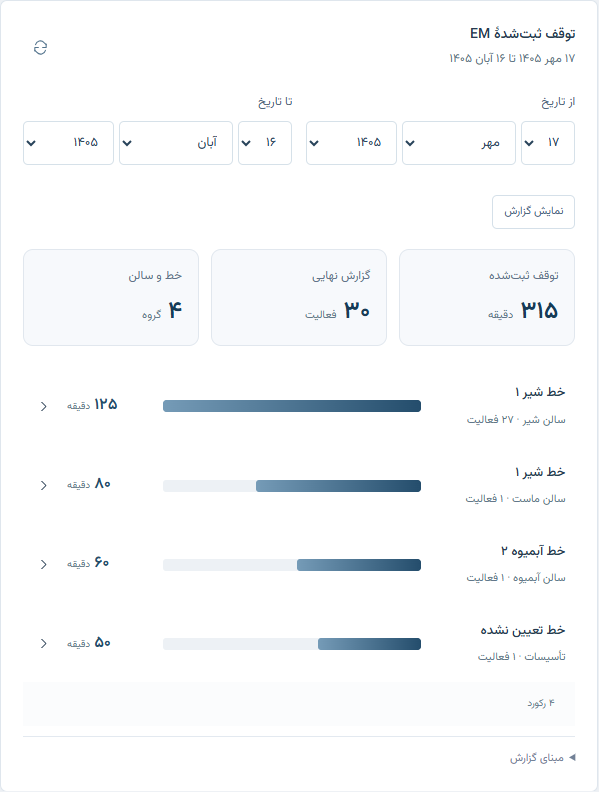
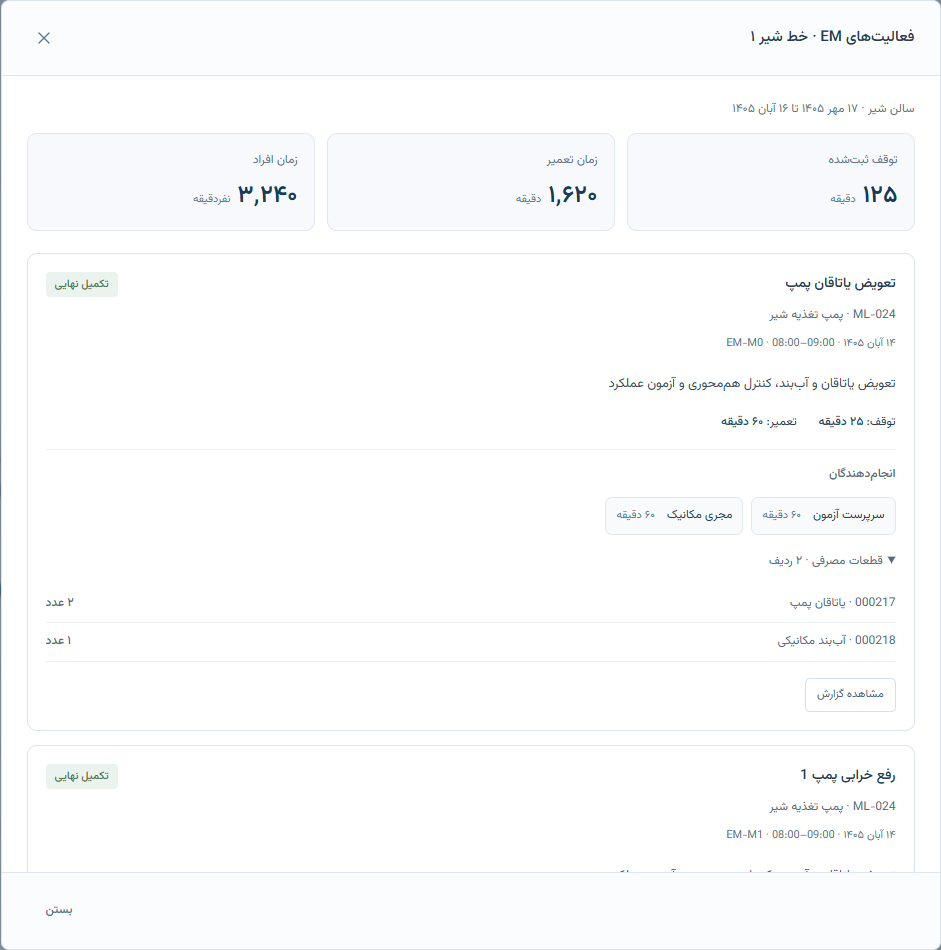

# توقف ثبت‌شدهٔ EM — تکمیل rc.12-r2

در r2 می‌توانید مدت توقف تولید را در گزارش رفع خرابی وارد کنید و از نمودار خط به فعالیت‌ها، نفرات و قطعات همان گزارش‌ها برسید. این قابلیت روی نسخهٔ محلی آماده شده است؛ داده یا تنظیمی در سرور شرکت تغییر نکرده است.

## ثبت توقف در گزارش کار

در فرم «ثبت گزارش کار»، ماهیت «رفع خرابی» یا EM را انتخاب کنید. کنار ساعت شروع و پایان تعمیر، «توقف تولید» و «مدت توقف» قرار دارند. اگر تولید متوقف شده است، آن را مشخص و مدت واقعی توقف را به دقیقه وارد کنید. مقدار مجاز، عدد صحیح از صفر تا ۱۴۴۰ است. زمان تعمیر و زمان هر انجام‌دهنده را جدا وارد کنید؛ برابر بودن این سه زمان الزامی نیست.

گزارش پس از طی تأییدهای معمول و تأیید نهایی وارد نمودار می‌شود. پیش‌نویس، گزارش منتظر تأیید، لغوشده، PM و پروژه در این نمودار جمع نمی‌شوند. ثبت توقف، مسیر نمره‌دهی و تأیید را عوض نمی‌کند.

## بازکردن فعالیت‌های یک خط

۱. در نمای مدیریت یا فهرست گزارش‌های کار، بخش «توقف ثبت‌شدهٔ EM» را باز کنید. تکنسین آن را در بخش «گزارش‌های من و وضعیت تأیید» هم می‌بیند.

۲. «از تاریخ» و «تا تاریخ» را انتخاب و «نمایش گزارش» را بزنید. بازهٔ پیش‌فرض ۳۰ روز اخیر است. ابتدا و انتهای بازه شامل می‌شوند و حداکثر بازه ۳۶۶ روز است؛ معیار تاریخ، تاریخ انجامِ گزارش است.

۳. روی ستون خط موردنظر بزنید. نام سالن کنار خط دیده می‌شود تا خط‌های هم‌نامِ سالن‌های متفاوت اشتباه انتخاب نشوند.

۴. در پنجرهٔ فعالیت‌ها، شرح کار، تجهیز، تاریخ و ساعت تعمیر، مدت توقف، نفرات و دقیقهٔ مشارکت هر نفر، قطعات مصرف‌شده و مقدار/واحد آن‌ها را ببینید. دکمهٔ «مشاهده گزارش» هر فعالیت، همان گزارش اصلی را با دسترسی معمول حساب باز می‌کند.

نمودار در هر صفحه ۱۰ گروه خط/سالن و فعالیت‌ها در هر صفحه ۲۵ گزارش دارند. برای دیدن همهٔ موارد، صفحه‌ها را عوض کنید. جمع بالای نمودار مربوط به کل بازه و جمع پنجرهٔ فعالیت‌ها مربوط به کل خط/سالن انتخاب‌شده است؛ جمع‌ها فقط از ردیف‌های صفحهٔ جاری ساخته نمی‌شوند.

## معنی عددها

- «توقف ثبت‌شده»: جمع مدت‌های معتبر `downtimeMinutes` در گزارش‌های نهایی EM که علامت معتبر `productionStopped=true` دارند.
- «زمان تعمیر»: جمع مدت تعمیر همین گزارش‌های مشمول؛ ممکن است با توقف تولید متفاوت باشد.
- «زمان افراد»: جمع دقیقهٔ مشارکت انجام‌دهندگان همین گزارش‌ها؛ نفر‌دقیقه است و توقف خط محسوب نمی‌شود.

صفرِ ثبت‌شده، صفر معلوم است. اگر علامت معتبر توقف وجود داشته باشد ولی مدت قدیمی خالی، نامعتبر یا خارج از محدوده باشد، گزارش با عنوان «مدت نامشخص» مشخص می‌شود؛ جمع فقط مدت‌های معلوم را شامل می‌شود. اگر تمام مدت‌های گروه نامشخص باشند، عدد صفر به‌عنوان توقف معلوم نمایش داده نمی‌شود. متن نامعتبر به جای علامت منطقی توقف یا بدنهٔ خرابِ گزارش، شرط ثبت توقف معتبر را تأمین نمی‌کند.

این نمودار مجموع توقف‌های ثبت‌شده در گزارش‌هاست. اگر دو گزارش توقف هم‌زمان یک خط را ثبت کرده باشند، هر دو در جمع می‌آیند. شروع و پایان مستقلِ هر توقف برای حذف هم‌پوشانی ثبت نشده است؛ بنابراین این عدد توقف یکتای خط یا محاسبهٔ OEE نیست. هیچ رابطه‌ای میان دستورکار EM و رویداد مستقل OEE از روی شباهت نام حدس زده نمی‌شود. تعریف CIP و محاسبهٔ دسترس‌پذیری OEE حفظ شده‌اند.

## سالن، خط و دسترسی

گروه از سالن و خط فعلی تجهیز در شناسنامهٔ تجهیزات گرفته می‌شود، با تطبیق دقیق هر دو فیلد. دو خط هم‌نام در دو سالن مستقل می‌مانند. خط خالی، در گروه «خط تعیین نشده» دیده می‌شود. تغییر سالن یا خط فعلی تجهیز می‌تواند گزارش‌های قدیمیِ آن را به گروه تازه ببرد؛ این نمودار شناسنامهٔ تاریخی مکان تجهیز را منجمد نمی‌کند.

رئیس، مدیر و کارشناس نت می‌توانند گزارش‌های مجازِ سطح مدیریت را ببینند. سرپرست فقط گزارش‌های حوزهٔ خودش، از جمله کارهای هم‌تخصصِ قابل مشاهده با قواعد فعلی، و تکنسین فقط گزارش‌های قابل مشاهدهٔ حساب خودش را می‌بیند. جمع نمودار و صفحه‌های فعالیت نیز همین محدودیت را رعایت می‌کنند؛ عوض‌کردن نشانی یا نام سالن و خط، اختیار تازه‌ای نمی‌سازد. جزئیات نفرات و قطعات با قواعد گزارش اصلی برمی‌گردند و نمرهٔ محرمانهٔ فرد دیگر آزاد نمی‌شود.

## نصب و شواهد

این تکمیل، API ۷، ساختار اصلی ۱۰ و ماژول اختیاری OEE نسخهٔ ۱ را حفظ می‌کند؛ SQL یا ارتقای ساختار تازه ندارد. رابط و بک‌اند r2 را با هم نصب کنید. سلامت بک‌اند باید قابلیت `em-downtime-drilldown` را اعلام کند؛ رابط تازه، بک‌اند فاقد این قابلیت را سازگار نمی‌داند. فایل `.env`، دیتابیس، فایل‌های اصلی PM و پشتیبان‌های فعلی را نگه دارید.

بستهٔ r2 با نام `PAK-Update-rc12-2026-11-07-r2.zip` جدا از بستهٔ قبلی نگه داشته می‌شود. نتیجهٔ تکمیلی آزمون‌ها در `em-verification.json` و گزارش نهاییِ بسته ثبت می‌شود؛ شمارش‌های قبلیِ rc.12، سابقهٔ بررسیِ مبنا هستند. هیچ‌کدام پذیرش نصب یا داده‌های واقعی سرور شرکت را تأیید نمی‌کنند.

## تصویر اجرای آزمایشی

این تصاویر از رابط ساخته‌شده با دادهٔ مصنوعی‌اند؛ دادهٔ شرکت را نشان نمی‌دهند.

