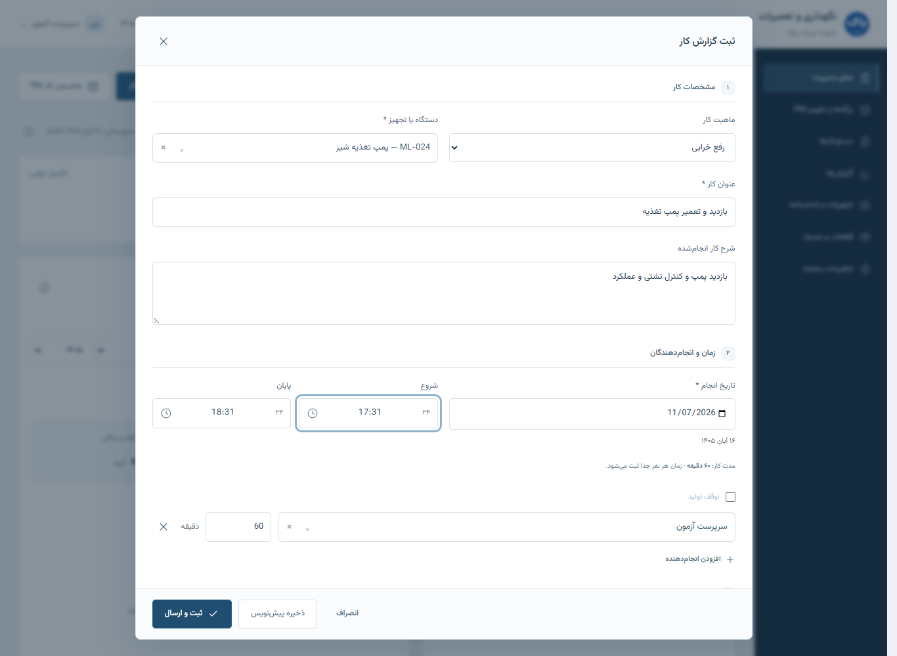

# یکپارچه‌سازی رابط rc.12

این تغییرها در نسخهٔ محلی آماده شده‌اند. سرور شرکت، دیتابیس زنده و Nginx تغییر نکرده‌اند. نسخهٔ تحویلی قبلی rc.11-r2 دست‌نخورده است.

## ثبت گزارش سرپرست و نمره‌ها

در «نمای مدیریت»، دکمهٔ «ثبت گزارش کار» بالای کارتابل سرپرست قرار دارد. گزارش جدیدِ عادی با مشارکت خود سرپرست باز می‌شود؛ تخصیص PM تازه با این عمل یکی نیست و فهرست انجام‌دهندگانِ گزارش قدیمی هم بازنویسی نمی‌شود.

طبق توضیح نهایی کاربر در ۵ نوامبر، این دکمه برای کاری است که خودِ سرپرست انجام داده است؛ در فرم جدیدِ او «تخصیص به» و «موعد انجام» نمایش داده نمی‌شوند. اطلاعات تخصیصِ گزارش‌های قبلی و فرم مستقل تخصیص PM حفظ شده‌اند.

برای سهم کار خودِ سرپرست، نمرهٔ سرپرست وجود ندارد؛ رئیس نمرهٔ مستقل از صفر تا ۹ می‌دهد. اگر تکنسینِ هم‌تخصص هم در گزارش باشد، سرپرست برای هر نفر جداگانه صفر تا ۳ ثبت می‌کند. تکنسینِ تخصص دیگر را سرپرست همان تخصص ارزیابی می‌کند. خودامتیازدهی و تغییر سیاست گزارش‌های قبلاً ارسال‌شده مجاز نشده‌اند. صفر معتبر است.

اگر پاسخِ ثبت گزارش نشان دهد تأییدِ سرپرست برای همکاران هم‌تخصص هنوز لازم است، جزئیات همان گزارش برای ارزیابی باز می‌شود؛ لازم نیست گزارش تازه را در فهرست جستجو کنید. گزارشِ فقط خود سرپرست چنین مرحله‌ای ندارد. این راهبری، مجوز یا نمرهٔ تازه‌ای در مرورگر نمی‌سازد و بر اساس پاسخ معتبرِ بک‌اند انجام می‌شود.

اصلاح زمان و قطعات، نمره‌دهی و تأیید سرپرست در همان فرمِ بررسی حفظ شده‌اند. مسیر «برگشت برای اصلاح» دوباره اضافه نشده است. تأییدهای معتبرِ قبلیِ تخصص‌های دیگر برای مشارکت‌های بدون تغییر حفظ می‌شوند؛ تأیید اولیهٔ تخصصِ هنوز منتظر حذف نمی‌شود.

## ساعت ۲۴ساعته

تمام ورودی‌های ساعتِ گزارش عادی، گزارش تکنسین، اجرای PM، اصلاح گزارش و برگهٔ OEE از کنترل مشترک استفاده می‌کنند. گزینهٔ AM/PM وجود ندارد. ساعت را می‌توان مثل `17:31` یا `1731` نوشت؛ رقم فارسی و عربی هم پذیرفته می‌شود. خروجی قابل ارسال همیشه `HH:mm` از `00:00` تا `23:59` است.

دکمهٔ ساعت، انتخابگر ساعتِ دوحلقه‌ای ۰۰ تا ۲۳ و سپس دقیقه را باز می‌کند. ساعت و دقیقه، جداگانه هم قابل نوشتن‌اند. «انتخاب» مقدار را در فرم می‌گذارد؛ Escape فقط پنجرهٔ ساعت را می‌بندد و فرم اصلی باز می‌ماند. مقدار نامعتبر، مقدار صحیحِ قبلی را پنهانی ارسال نمی‌کند. زمان پایانِ روز بعد، همچنان با قواعد قبلیِ گزارش محاسبه می‌شود.

## ظاهر و ساختار صفحه

- پس‌زمینهٔ طوسی روشن، سطوح سفید و آبی تیره برای اقدامات اصلی؛ فونت فارسی Vazirmatn همراه برنامه است و به اینترنتِ شرکت نیاز ندارد. مجوز فونت در `frontend/src/fonts/OFL.txt` و اعلان مجوزهای همراه رابط آمده است.
- نام «نگهداری و تعمیرات» در سربرگ، یک خط می‌ماند. آیکن‌ها خط نازک‌تری دارند. ابعاد فرم تکنسین حفظ شده‌اند.
- صفحهٔ اول، شاخص‌های خلاصه، چند گزارش منتظر اقدام و ورودی بخش‌ها را نشان می‌دهد. فهرست کامل PM، تاریخچهٔ کارها و گزارش عملکرد کارکنان هنگام انتخاب همان بخش باز می‌شوند. اطلاعات مدیریتی از API واقعی می‌آیند؛ دادهٔ نمونهٔ پیش‌نمایش وارد برنامه نشده است.
- خلاصهٔ «عملکرد من» همچنان برای هر حساب در کارتابل خودش دیده می‌شود. فیلترها، روش محاسبه و ریز فعالیت‌ها با بازکردن جزئیات نمایش داده می‌شوند. گزارش همهٔ کارکنان برای رئیس باقی است.
- متن‌های تبلیغی و توضیح‌های بدیهیِ سربرگ حذف شده‌اند. راهنمای لازم، خطای اعتبارسنجی، علت اصلاح و محدودیت دسترسی حفظ شده‌اند.

## تازه‌سازی و سرعت

تازه‌سازیِ همان فهرست، دادهٔ موجود را نگه می‌دارد و محتوای صفحه را با پیام بارگذاری جایگزین نمی‌کند. درخواست‌ها روی هم انباشته نمی‌شوند؛ چند تازه‌سازی پیاپی حداکثر یک درخواست جاری و یک دریافتِ بعدی ایجاد می‌کند. تایمرها در صفحهٔ مخفی یا وضعیت آفلاین دریافت تازه راه نمی‌اندازند و هنگام خروج از بخش پاک می‌شوند.

با عوض‌شدن فیلتر، نشانی یا نشست، پاسخ قدیمی به بخش تازه منتقل نمی‌شود. پاسخِ دسترسی‌نداشتن، دادهٔ ذخیره‌شدهٔ آن دریافت را پاک می‌کند. کل فهرست گزارش‌ها و کل کارتابل PM هم‌زمان در صفحهٔ اول بارگیری نمی‌شوند. آزمون این رفتارها در `frontend/tests/resources.test.mjs` است.

در بازنگری نهایی، خروج از OEE با دکمه‌های Back و Forward مرورگر هم کنترل شد. اگر فرم ذخیره نشده باشد، ردِ خروج یادداشت و فرم را نگه می‌دارد؛ مسیرهای برگشت و جلو دوباره‌سازی نمی‌شوند. این رفتار علاوه بر آزمون واحد، در رابط ساخته‌شده با مرورگر بررسی شده است.

این تغییرها، قرارداد API ۷ و ساختار دیتابیس ۱۰ را عوض نمی‌کنند و SQL تازه‌ای ندارند. برای ارتقا از نسخه‌های قدیمی، راهنمای `update-rc12-fa.md` همچنان ملاک است.

## نمودار و ثبت توقف EM — تکمیل r2

در r2، ورود «توقف تولید» و «مدت توقف» در فرم گزارش کار کنار ساعت‌های تعمیر دیده می‌شود. نمودار «توقف ثبت‌شدهٔ EM» در نمای مدیریت و فهرست گزارش‌های کار قرار دارد. با کلیک بر خط، فعالیت‌های همان سالن، همان خط و همان بازه باز می‌شوند؛ شرح، نفرات، دقیقهٔ مشارکت، قطعات و جزئیات اصلی گزارش قابل مشاهده‌اند. نمودار و فعالیت‌ها صفحه‌بندی کامل دارند. راهنمای استفاده و قواعد دقیق در [توقف ثبت‌شدهٔ EM](em-downtime-fa.md) است.

معیار، جمع مدت توقفِ معتبرِ گزارش‌های نهایی EM با توقف تولید است؛ مدت تعمیر و نفر‌دقیقه جدا هستند. مدتِ نامشخص صفر ساخته نمی‌شود؛ گروه‌بندی از سالن/خط فعلیِ تجهیز است و دو خط هم‌نامِ دو سالن مخلوط نمی‌شوند. هم‌پوشانیِ توقف‌ها حذف نمی‌شود و رابطه‌ای با رویداد OEE ساخته نشده است. دسترسی همان گزارش اصلی حفظ می‌شود.

API ۷ و ساختار ۱۰ تغییر نمی‌کنند و SQL تازه‌ای لازم نیست. نصبِ رابط و بک‌اند هماهنگ r2 با قابلیت `em-downtime-drilldown` لازم است. فایل تاریخی `rc12-ui-design-pending-fa.md` اکنون سابقهٔ درخواست و اجرای آن را توضیح می‌دهد؛ قابلیت در r2 معلق نیست.

## بررسی محلی

گزارش ماشین‌خوانِ اجرای آزمون‌ها در `rc12-ui-verification.json` قرار می‌گیرد. آزمون مرورگر با رابط ساخته‌شده و API آزمایشیِ کنترل‌شده انجام می‌شود؛ آزمون منطق نمره و گردش کار نیز جداگانه روی داده‌های مصنوعی انجام شده است. این بررسی، تأیید نصب یا اتصال به سرور شرکت نیست.

نتیجهٔ نهایی در ۵ نوامبر ۲۰۲۶: هر ۱۰۵ آزمون رابط، ۲۱ آزمون بک‌اندِ گزارش سرپرست/اصلاح و ۱۵ بررسی مرورگر گذشتند؛ مورد اجرا‌نشده‌ای در این انتخاب‌ها نبود. بررسی TypeScript و ساخت نهایی هم موفق بود. آزمون‌های مرورگر، ثبتِ کار خود سرپرست، ارزیابی همکاران بدون خودامتیازدهی، نمرهٔ ۰ تا ۹ رئیس، ساعت فارسی و انتخابگر، Escape تو‌در‌تو، رد ساعت نامعتبر، فیلتر PM و ثبات تازه‌سازی را پوشش دادند.

بازنگریِ تحویل ۷ نوامبر، شواهد بالا را با ۱۱۰ آزمون رابط، ۱۶ بررسی مرورگرِ فرم‌ها و ۵ بررسیِ مسیر OEE تکمیل می‌کند؛ نتیجهٔ کامل و حدود آزمون در `release-review-verification.json` و `rc12-release-review-fa.md` است.

شمارش‌های بالا متعلق به مبنای rc.12 پیش از تکمیل EM هستند و بازنویسی نشده‌اند. شواهد تکمیلی r2 برای ورود توقف، جمع صحیح، محدودهٔ دسترسی و بازشدن خط تا جزئیات، جداگانه در `em-verification.json` و گزارش بازنگری بسته ثبت می‌شوند.

تصویر فرم واقعیِ ساخته‌شده، با دادهٔ آزمایشی و بدون اتصال به سرور شرکت:

